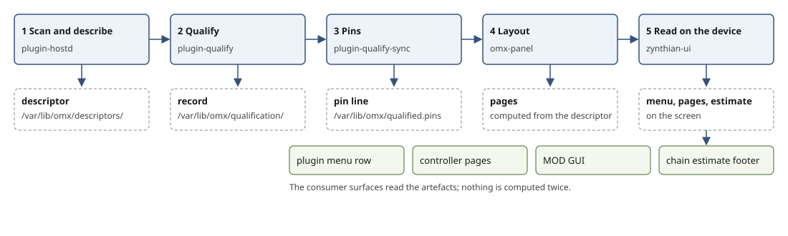

From a plugin file to a page on the screen
==========================================

An instrument on a Zynthian is a file on the disk: a CLAP or LV2 binary. What the player sees is a row in a menu with
its figures, a chain with a MIDI input, controller pages with knobs, a MOD GUI, and a footer saying what the chain will
cost. Five stages turn one into the other. Each stage has one owner, writes one artefact in a fixed place, and what
comes after reads that artefact and nothing else.

The running example is an instrument. [Kars](https://github.com/DISTRHO/Kars) (LV2, a plucked-string synth) is
used wherever there is a [capture from the device](zynthian/captures.md); Surge XT (CLAP, installed on the Pi 5) is
named where its figures matter, and an effect appears once, to show where the layout differs.

(The figure is drawn by [tools/figures/from-file-to-page.py](https://github.com/FreeMixer/plugin-hostd/blob/main/tools/figures/from-file-to-page.py).)

1. Scan and describe
--------------------

**Owner:** plugin-hostd. **Writes:** the descriptor, one JSON document per plugin binary under
`/var/lib/omx/descriptors`, named `<id>@<version>-<hash>.json` (README, `descriptor_dir`).

The daemon's describe loads the plugin once in the matching host (omx-clap-host for CLAP, and for the LV2 plugins its
adapter takes; mod-host for the rest) and reads everything the plugin declares: id and version, audio and MIDI ports,
every parameter with symbol, name, unit, range, default, steps or enumeration, flags, declared latency, and the
extensions it supports. How the plugin's own description maps to the descriptor is in [the format tables](formats.md).

For an instrument the descriptor says what an effect's does not: a MIDI input port (and so the notes it takes), its
parameters, and its presets. Kars's descriptor has the three parameters the engine later shows on its one page,
Sustain, Release and Volume.

The descriptor must fit the contract. omx-contract defines the vocabulary (units, port kinds, scopes, outcome codes) and
plugin-hostd-contract the verbs and codes; a scan that finds an unknown unit or field is refused, not invented.

Our own plugins skip the scan. Their parameters are authored once in a declaration, and the generator writes the
descriptor, the LV2 bundle, the CLAP parameters and the parameter reference from it
([omx-plugins, docs/plugins/README.md](https://github.com/FreeMixer/omx-plugins/tree/main/docs/plugins)).

2. Qualify
----------

**Owner:** plugin-qualify. **Writes:** the qualification record, `<plugin>@<version>-<hash>.<offer>.qualification.json`
with the probe output it judged beside it, under `/var/lib/omx/qualification`.

The probe runs the plugin at every cell of the grid (rates 44.1, 48, 96 and 192 kHz times block sizes 128, 256, 512 and
1024) and writes the record: the checksums of the binary's files, cost per block, declared and measured latency, RT
safety under the interposer, or a reason code for each cell that did not run. For an instrument the probe plays notes
as well as sweeping parameters, so the record carries what a held voice costs, not only an idle plugin.

The verdict for each host follows: suitable, isolated (it runs in a worker of its own and is never grouped), or
unsuitable. Kars's record rates it suitable for omx-clap-host, with RT safety clean under a parameter sweep and under
notes, hosted isolated. An instrument that allocates or locks on the audio thread gets the same isolated verdict, and
what that means for hosting is the next stage. The Pi numbers are in [Benchmarks](zynthian/benchmarks.md#qualification-of-every-plugin-on-the-pi).
Surge XT's figures belong to the instruments page of the Zynthian section, which is not published yet.

3. Pins
-------

**Owner:** plugin-qualify (its sync). **Writes:** `/var/lib/omx/qualified.pins`, one line per plugin.

From the records the sync writes one line per plugin saying what plugin-hostd may host and how ([Pins in the
README](../README.md#pins)). The daemon loads the pins as its only source of permission. The planner reads them to group
workers and to place them on cores ([placement](placement.md)). For an instrument the line says hosted, and if the
record said isolated, in a worker of its own; an instrument is never put into a chain's shared worker, so a fault or a
late buffer in a voice cannot reach the effects after it.

That is also what the cores need. Surge XT 1.4.0 ignores CLAP's thread-pool extension, so one instrument is one audio
thread. Several instruments use several cores when each is in its own worker and the workers are spread over the audio
cores, the daemon kept off them; the measurement with two and three instruments is in
[placement on the Pi 5](evidence/placement-pi5-2026-10-29/README.md).

4. Layout
---------

**Owner:** omx-panel. **Writes:** the pages, computed from the descriptor by `omx-panel layout --descriptor`; the
record keeps the layout scheme and hash it was judged against.

The layout turns a descriptor's parameters into pages: sections become groups, every control gets a stable key. The same
layout drives the engine's controller pages in zynthian-ui, the MOD GUI that omx-modgui-sync generates for mod-ui, and
the complement bundle that adds groups to third-party LV2 plugins ([omx-panel, docs/lv2-complement.md](https://github.com/FreeMixer/omx-panel/blob/main/docs/lv2-complement.md)).

Kars has one group of three knobs, and so one page, "Controls". An effect lays out differently: our equaliser puts
each band on a page of its own. See [the panel](panel.md).

5. Read on the device
---------------------

**Owner:** zynthian-ui, with the daemon. **Writes:** nothing; it reads.

zynthian-ui reads the pins for its menus, the records for latency, RT safety and cost on each row, and the layout for
the pages. Before an insert it asks the daemon's estimate verb what the chain will cost. Nothing is computed twice:
descriptor for parameters, record for figures, pin for permission, layout for pages.

On the device, for Kars:

- the plugin-menu row with its figures: tier, latency as measured/declared frames, RT safety
  ([list-by-tier.png](zynthian/evidence/captures-2026-10-29/kars/list-by-tier.png));
- the engine's controller page ([controller-page-1-controls.png](zynthian/evidence/captures-2026-10-29/kars/controller-page-1-controls.png));
- the MOD GUI from the same layout ([modgui-pedalboard.png](zynthian/evidence/captures-2026-10-29/kars/modgui-pedalboard.png));
- the chain with the instrument ([chain-view-kars-zamcomp.png](zynthian/evidence/captures-2026-10-29/common/chain-view-kars-zamcomp.png));
- the chain estimate footer, which reads "estimate unavailable" on plugin-hostd 0.13.1 and is described in
  [Usage information](zynthian/captures.md#usage-information).

The rows sorted by latency or cost are the other captures in [the same set](zynthian/captures.md).

A fresh device does not repeat the long stage. The distributed package ships the records and pins of a known plugin set,
keyed by checksums, so a fresh device applies them and probes only what differs
([omx-qualification-records](https://github.com/FreeMixer/omx-qualification-records#readme)).
