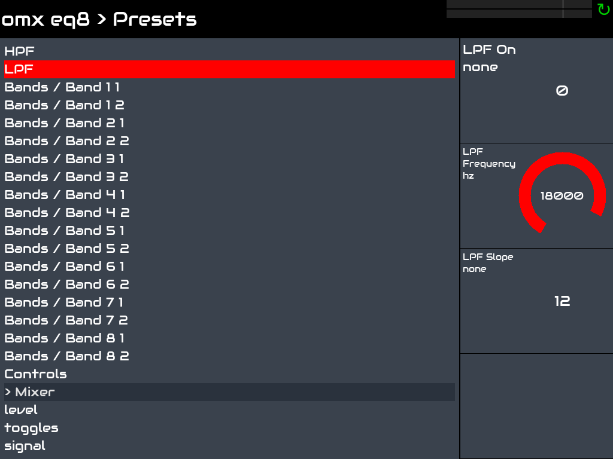

Start here: plugin-hostd in four paragraphs
===========================================

plugin-hostd gives a Zynthian three things it already does in its own way. Each is optional and taken or left on its
own: a maintainer who wants only one merges only that step of [the patch series](zynthian/upstream-series.md).

- Plugin hosting: in place of one jalv per plugin, plugin-hostd hosts the LV2 and CLAP plugins, and a qualification on
  the device says which are safe to load. Set `ZYNTHIAN_PLUGIN_ENGINE=plugin-hostd`, or `jalv` to go back.
- Grouping: your chain manager stays as it is; we only change how its plugins run. When several plugins of a chain are
  plugin-hostd processors, their records say which may share one process and which run alone, and the UI shows the
  chain's cost and latency before you add. It comes with the plugin-hostd engine.
- Panels: in place of hand-made control pages and MOD GUIs, both are drawn from the plugin's one description. With
  omx-panel installed the pages follow the plugin-hostd engine, the GUIs its sync service; a plugin's own GUI is kept.

omx eq8 on a Pi 5 running Zynthian: the screens follow the plugin's own sections, here its low-pass filter.

If you read one page, make it [from a plugin file to a page on the screen](from-file-to-page.md).

It runs on a Pi 5. [The status page](zynthian/status.md) says what is proven on the device, what is released and
waits for its device proof, and what is still open.

A look, a question, or a plugin you would like qualified are all welcome: [open an
issue](https://github.com/FreeMixer/plugin-hostd/issues).

**What it is.** plugin-hostd is a daemon that runs audio plugins for a controller. A controller (Zynthian's engine,
MOD-UI, a mixing console, your own program) opens its socket and speaks mod-host's protocol: same ports, same verbs,
same replies, plus the verbs plugin-hostd adds. A plugin that crashes takes down its own worker and nothing else, and
the worker is put back with its settings. The [README](../README.md) has the verbs and the error codes; the
[wire protocol](protocol.md) states every message.

**What it hosts.** LV2 and CLAP plugins, side by side. CLAP plugins, and the LV2 plugins its adapter takes, run in
omx-clap-host; the LV2 plugins the adapter refuses run in mod-host. How a plugin's own description becomes the
descriptor a controller reads is in [the format tables](formats.md); the panel a plugin publishes for a host to draw
is in [the panel](panel.md), and presets in [presets in the host](presets.md).

**How it runs.** The daemon holds no audio: every worker is a JACK client, as in mod-host, and the daemon starts,
watches and restarts the workers. A plugin runs in a worker of its own, in a named pool, or in a chain whose plugins
share one worker; which plugins may share is decided from their pins and from what the daemon has seen them do, and a
plugin that keeps crashing is singled out and given up on without touching its neighbours. Each plugin is pinned
(its files' hashes and its parameter layout) before it runs; see Pins in the [README](../README.md#pins).

**Install.** From the OpenMixer channel. Debian bookworm and trixie and Raspberry Pi OS, amd64 and arm64:

    curl -fsSLO https://www.openmixer.org/deb/openmixer-release.deb && sudo apt install ./openmixer-release.deb
    sudo apt update && sudo apt install plugin-hostd omx-clap-host

Fedora:

    sudo dnf install https://www.openmixer.org/rpm/openmixer-release.noarch.rpm
    sudo dnf install plugin-hostd omx-clap-host

Then [use plugin-hostd in your own host](own-host.md) takes a Debian machine from nothing to a plugin running under
the daemon, in the commands CI runs; building from source is in [BUILDING.md](../BUILDING.md).
