Zynthian and plugin-hostd: the measurements
===========================================

What was measured, on what, and from which file. Every number in this page is read from a file committed under
[evidence/](evidence/) or from a file on the device named with its sha256; a row with no file says "not measured yet"
and gives the command that would measure it. The pros and cons drawn from these numbers are in
[tradeoffs.md](tradeoffs.md); the acceptance report the bench tool writes is [acceptance-report.md](acceptance-report.md).

The device in every Pi row: a Raspberry Pi 5 (Cortex-A76, 4 cores, 4 GB), ZynthianOS vangelis (Debian 13 arm64), kernel
6.18.50+rpt-rpi-2712 (not PREEMPT_RT). Its JACK ran on the ALSA `Dummy` card in these runs, and every
benchmark ran on a private JACK server on the dummy driver. DSP load, xruns and latency below are the dummy driver's.
Until the fork's update script was applied to the device
(`sbin/mod-host-backend.sh`, `ZYNTHIAN_MODHOST_BACKEND="plugin-hostd"` after it), its MOD-UI engine ran
the stock mod-host (`/usr/local/bin/mod-host`, v0.10.6-595-g6c1cdd8, as the image ships it). Every mod-host row below,
before and after that, is that stock binary, started by the bench on a private port of its own; no row measures MOD-UI
or the device's own mod-host service.

Contents:

1. [Grouped versus alone: plugin-hostd, jalv, mod-host](#grouped-versus-alone-plugin-hostd-jalv-mod-host)
2. [The four hosts, one plugin and short chains](#the-four-hosts-one-plugin-and-short-chains)
3. [Qualification of every plugin on the Pi](#qualification-of-every-plugin-on-the-pi)
4. [The chain round trip](#the-chain-round-trip)
5. [mod-ui's verbs: mod-host against plugin-hostd](#mod-uis-verbs-mod-host-against-plugin-hostd)
6. [Voices across the cores](#voices-across-the-cores)
7. [Current versions: chains up to 24 plugins](#current-versions-chains-up-to-24-plugins)
8. [Instruments on the cores](#instruments-on-the-cores)
9. [The matrix: every rate and quantum, single and grouped](#the-matrix-every-rate-and-quantum-single-and-grouped)
10. [What is not measured yet](#what-is-not-measured-yet)
11. [Reproducing](#reproducing)

Grouped versus alone: plugin-hostd, jalv, mod-host
--------------------------------------------------

The same N plugins in series, run five ways, at the same rate and quantum, on the device's private JACK server:

| mode | what runs |
|---|---|
| plugin-hostd, chain | the daemon and one worker for the whole chain (`chain 1 <ids>`) |
| plugin-hostd, individual | the daemon and one worker per plugin |
| omx-clap-host alone | one omx-clap-host process for every plugin |
| mod-host | one mod-host process for every plugin (LV2 builds of our plugins) |
| jalv | one jalv process per plugin (LV2 builds of our plugins) |

The plugins cycle omx-comp (CLAP), Calf Compressor (LV2), omx-delay (CLAP) and omx-drive (CLAP); under mod-host and
jalv the LV2 builds of the omx plugins stand in for the CLAP ones (each row's note says so).

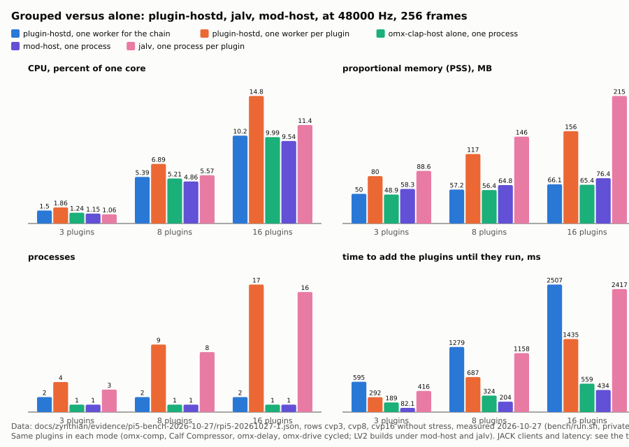

The figure shows, for 3, 8 and 16 plugins at 48000 Hz and 256 frames, the CPU, proportional memory, process count and
add time of each mode, from run `rpi5-20261027-1`
([evidence/pi5-bench-2026-10-27/rpi5-20261027-1.json](evidence/pi5-bench-2026-10-27/rpi5-20261027-1.json),
governor `performance`, plugin-hostd 0.12.0, omx-clap-host 0.22.1, jalv 1.6.9 and mod-host 0.10.6-595-g6c1cdd8 as the
image ships them).

48000 Hz, 256 frames, no stress, one 10 s window per row (same file):

| N | mode | processes | CPU, % of a core | DSP load, % | RSS MB | PSS MB | add ms |
|---|---|---|---|---|---|---|---|
| 3 | plugin-hostd, chain | 2 | 1.50 | 1.30 | 121.7 | 50.0 | 595 |
| 3 | plugin-hostd, individual | 4 | 1.86 | 1.33 | 337.6 | 80.0 | 292 |
| 3 | omx-clap-host alone | 1 | 1.24 | 1.47 | 119.2 | 48.9 | 189 |
| 3 | mod-host | 1 | 1.15 | 1.17 | 128.7 | 58.3 | 82 |
| 3 | jalv | 3 | 1.06 | 1.26 | 345.0 | 88.6 | 416 |
| 8 | plugin-hostd, chain | 2 | 5.39 | 5.11 | 129.0 | 57.2 | 1279 |
| 8 | plugin-hostd, individual | 9 | 6.89 | 5.35 | 890.1 | 117.1 | 687 |
| 8 | omx-clap-host alone | 1 | 5.21 | 5.07 | 127.3 | 56.4 | 324 |
| 8 | mod-host | 1 | 4.86 | 4.79 | 134.7 | 64.8 | 204 |
| 8 | jalv | 8 | 5.57 | 5.36 | 917.9 | 146.3 | 1158 |
| 16 | plugin-hostd, chain | 2 | 10.16 | 9.76 | 138.1 | 66.1 | 2507 |
| 16 | plugin-hostd, individual | 17 | 14.75 | 10.90 | 1782.8 | 155.6 | 1435 |
| 16 | omx-clap-host alone | 1 | 9.99 | 9.71 | 137.0 | 65.4 | 559 |
| 16 | mod-host | 1 | 9.54 | 9.40 | 147.1 | 76.4 | 434 |
| 16 | jalv | 16 | 11.39 | 11.01 | 1834.9 | 215.0 | 2417 |

The same rows at 96000 Hz are in the file and in [acceptance-report.md](acceptance-report.md). RSS counts each
process's shared libraries again; PSS shares them out, so PSS is the memory the device actually spends. `add ms` is from
the first `add` to the last reply, for the chain mode until the chain runs, for jalv until the last client is in the
graph.

JACK clients per chain and xruns. The omx-bench rows of `rpi5-20261027-1` do not record them. The chain-only run made
with it, [evidence/pi5-bench-2026-10-27/grouped-vs-processes.md](evidence/pi5-bench-2026-10-27/grouped-vs-processes.md)
(raw rows in `grouped-vs-processes.jsonl`, script `gvp.py`; plugin-hostd 0.12.0, all-CLAP chains of omx plugins, 256
frames, private JACK), counts them for plugin-hostd only:

| rate | N | mode | JACK clients | processes | PSS MB | cpu % | xruns in 10 s |
|---|---|---|---|---|---|---|---|
| 48000 | 3 | grouped | 1 | 2 | 31.0 | 2.1 | 0 |
| 48000 | 3 | individual | 3 | 4 | 59.0 | 2.6 | 0 |
| 48000 | 8 | grouped | 1 | 2 | 35.6 | 3.9 | 0 |
| 48000 | 8 | individual | 8 | 9 | 92.7 | 6.3 | 0 |
| 48000 | 16 | grouped | 1 | 2 | 42.9 | 7.2 | 0 |
| 48000 | 16 | individual | 16 | 17 | 118.2 | 13.39 | 0 |

Summed over its 12 runs per mode (both rates, with and without stress), that file counts 10 xruns grouped and 41
individual, from single 10 s windows; read them as a count, not a rate. jalv's JACK clients are one per plugin by
construction (one process, one client); mod-host's are one per plugin instance inside its one process. Neither was
counted on the device: not measured yet.

The run `rpi5-20261028-1` (below) adds xruns and declared latency for N = 3 under all five modes.

Run `rpi5-20261028-1`, eleven minutes
([evidence/pi5-bench-2026-10-28/rpi5-20261028-1.json](evidence/pi5-bench-2026-10-28/rpi5-20261028-1.json), the
console output `run.out` and every host's log under `logs/`): plugin-hostd 0.13.1, omx-clap-host 0.23.2, omx-plugins
0.15.1, the stock mod-host and jalv; 48000 Hz, 256 frames, three repeats of a 10 s window per row (the median, the spread
in the file), governor left at `powersave`. The command:

    bench/run.sh --class rpi5 --out out --rates 48000 --frames 256 --scenarios idle,lv2-1,chain3,kill1,cvp3 \
        --hosts H1,H2,H3,H4 --repeats 3 --window 10 --stress none --keep-governor --logs logs

`cvp3`, three plugins (omx-comp, Calf Compressor, omx-delay):

| mode | processes | CPU, % of a core | DSP load, % | RSS MB | PSS MB | add ms | xruns | declared latency, frames |
|---|---|---|---|---|---|---|---|---|
| plugin-hostd, chain | 2 | 1.5 | 1.31 | 122.1 | 40.3 | 595.5 | 0 | 0 |
| plugin-hostd, individual | 4 | 1.77 | 1.3 | 338.2 | 68.2 | 291.9 | 0 | 0 |
| omx-clap-host alone | 1 | 1.41 | 1.38 | 120.0 | 39.3 | 184.2 | 0 | 0 |
| mod-host | 1 | 1.24 | 1.26 | 163.6 | 82.6 | 86.9 | 0 | 0 |
| jalv | 3 | 1.41 | 1.35 | 447.3 | 178.9 | 2917.6 | 0 | 0 |

The chain row's note reads `one worker, 3 JACK clients`: with an LV2 member (Calf) on the adapter row the chain is one
worker but not one JACK client; the one-client chain of grouped-vs-processes.md is an all-CLAP chain. `kill1` repeats
the result of `rpi5-20261027-1`: plugin-hostd recovers in 346.7 ms, the other three hosts lose the process.

Latency. The bench records the latency JACK reports at `system:playback_1`, which is what the clients on the path
declare, not a measurement of audio; the omx plugins in these chains declare none. A measured round-trip latency per
host needs a loopback cable through the audio interface: not measured yet.

At scale, chains of four LV2 plugins at 1, 2, 4, 8 and 16 chains, each level held 60 s on the system JACK server of
the Zynthian, grouped (one worker per chain), alone (one worker per plugin) and on jalv: [stress.md](stress.md)
(plugin-hostd 0.13.1, omx-clap-host 0.23.2, 48000 Hz, 256 frames, 1500 MHz, CPU from the scheduler's ns
counters). At 16 chains the hosting processes used 70.6 % of a core grouped (60 plugins), 100.8 % alone (60) and
82.3 % on jalv (64); PSS 224.2, 359.3 and 2745.6 MB; `jack_lsp` counted 46, 70 and 74 JACK clients, 10 of them the
idle graph's. Grouped and alone reached 16 chains without a limit; jalv stopped there on memory, with 2 xruns.

The four hosts, one plugin and short chains
-------------------------------------------

From the same file, 48000 Hz and 256 frames (DSP load average, %; RSS MB; processes):

| scenario | omx-clap-host alone | plugin-hostd | mod-host | jalv |
|---|---|---|---|---|
| the host, no plugin | 0.13; 107.6; 1 | 0.15; 1.1; 1 | 0.19; 121.7; 1 | jalv has no host without a plugin |
| one CLAP plugin (omx-comp) | 0.57; 108.7; 1 | 0.55; 110.8; 2 | runs LV2 only | runs LV2 only |
| one LV2 plugin (Calf Compressor) | 0.70; 115.7; 1 | 0.70; 118.9; 2 | 0.72; 125.2; 1 | 0.72; 115.8; 1 |
| three in series | 1.31; 120.4; 1 | 1.33; 122.5; 2 | 1.17; 129.2; 1 | 1.29; 345.1; 3 |
| 16 instances of omx-comp | 6.08; 112.7; 1 | 7.19; 1736.5; 17 | 5.32; 132.7; 1 | 6.69; 1813.3; 16 |

The 16-instance row runs plugin-hostd without a chain, one worker each: it is the individual mode, not the grouped one.

Recovery after `kill -9` of the process that holds one plugin (`kill1`, same file): plugin-hostd puts the worker back
and re-wires it in 347 ms at 48000 Hz and 336 ms at 96000 Hz; under omx-clap-host alone, mod-host and jalv the killed
process is the host, so the row is `failed` with the note `host process lost`: nothing brings the plugin back.

Qualification of every plugin on the Pi
---------------------------------------

`plugin-qualify --all --isolate` over every LV2 and CLAP plugin on the device, 2026-10-28T14:51:58Z to 20:51:49Z,
plugin-qualify 0.16.1, every probe run by `plugin-hostd-probe 0.13.1`, four host profiles asked for: jalv (one process
per plugin), mod-host (shared process), omx-clap-host (shared process; the profile of plugin-hostd's worker) and
openmixer-console (in-process). The governor was `powersave` and the probes were not pinned to a core. Source:
`/root/omx-deep-20261028/qualify.json` on the device (11824126 bytes, sha256
`b9c335c4dc0d8c41ec044da5eada619845aed86441610c6fbcf9b49c8347caf3`) and its `records/` directory, summarised by
`tools/zynthian/qualify-summary.py` into
[evidence/pi5-qualify-2026-10-28/summary.json](evidence/pi5-qualify-2026-10-28/summary.json) and
[tables.md](evidence/pi5-qualify-2026-10-28/tables.md); the commands and every file's sha256 are in that directory's
[README](evidence/pi5-qualify-2026-10-28/README.md).

What was asked and what came back (qualify.err, summary.json):

| | count |
|---|---|
| plugins plugin-qualify set out to qualify | 1337 LV2 + 247 CLAP |
| LV2 plugins with no document (`probe.unpinnable`: a file named by a percent-encoded IRI, which plugin-hostd does not decode: Pianoteq 9, Surge XT, Surge XT Effects, KR-106 and four dusk-audio plugins) | 8 |
| qualification records | 1823 (1329 LV2 + 494 CLAP; each CLAP plugin twice: the default offer and plugin-hostd's offer) |
| probe outcomes | 1658 `probe.ok`, 124 `probe.crashed`, 40 `probe.timeout`, 1 `probe.refused-instantiation` |
| crash signals in the probe documents | 104 SIGSEGV, 14 SIGABRT, 6 SIGKILL, all in the lifecycle step |
| plugin-qualify exit status | 2 (run.log) |

The 6 SIGKILLs came 3.0 to 5.0 s into the lifecycle step (2997 to 4966 ms), far inside the 240 s wall-clock limit, and plugin-qualify#193
reports them as OOM kills of the sampler. The device's kernel log of that boot was not kept (no persistent journal), so
the files record the signal and not who sent it.

### Suitable, isolated, unsuitable per host

The classes (plugin-qualify#196, plugin-hostd#231): **a plugin that fails the RT-safety sweep is isolated, not
unsuitable: it runs in a worker of its own and is never grouped with RT-safe plugins; unsuitable is only a crash, a
hang, a load failure or behaviour that breaks the host.** The records were written before that decision and say
`unsuitable` for both; the classes below are derived from each verdict's deciding code by
`tools/zynthian/qualify-summary.py`: `hosting.rt-safety.violations-*` is isolated; `probe.crashed`, `probe.timeout`,
`probe.refused-instantiation` and `mod-host.*` (a SIGABRT or no answer from mod-host) are unsuitable;
`hosting.clap.format-not-hosted` (jalv and mod-host do not load CLAP) and `hosting.rt-safety.unmeasured` are neither.

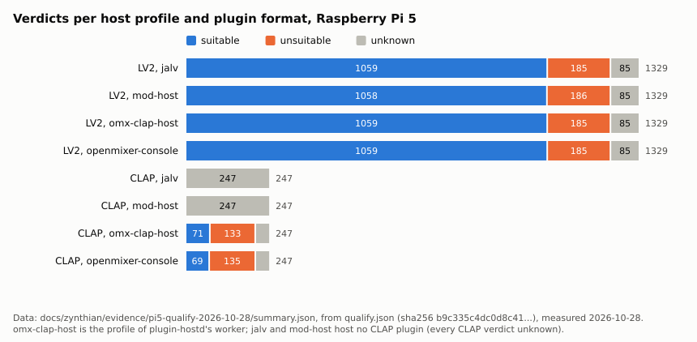

The figure shows, for each host profile and plugin format, how many plugins are suitable, isolated, unsuitable, not
loadable by that host, or unknown (summary.json `classes_by_format`).

| host profile | format | suitable | isolated | unsuitable | format not hosted | unknown | of |
|---|---|---|---|---|---|---|---|
| jalv | LV2 | 1059 | 185 | 79 | 0 | 6 | 1329 |
| mod-host | LV2 | 1058 | 183 | 82 | 0 | 6 | 1329 |
| omx-clap-host (plugin-hostd's worker) | LV2 | 1059 | 185 | 79 | 0 | 6 | 1329 |
| openmixer-console | LV2 | 1059 | 185 | 79 | 0 | 6 | 1329 |
| jalv | CLAP | 0 | 0 | 43 | 204 | 0 | 247 |
| mod-host | CLAP | 0 | 0 | 43 | 204 | 0 | 247 |
| omx-clap-host (plugin-hostd's worker) | CLAP | 71 | 133 | 43 | 0 | 0 | 247 |
| openmixer-console | CLAP | 69 | 135 | 43 | 0 | 0 | 247 |

The 43 unsuitable CLAP rows under jalv and mod-host are the probe's own crashes and timeouts of those plugins (the
probe ran each CLAP plugin once for every profile), not a load by jalv or mod-host. mod-host's LV2 row differs from the
others by three plugins it broke on: two SIGABRTs and one that left it without an answer.

What reached the device's pin file after `plugin-qualify-sync --system --force` (system `qualified.pins`, sha256
`3bb157e247b15774a4fc1bc648db73d1683a689c2346c90a70f1c5a895aa11f1`): 1187 pins `verdict=in-process`, 305
`verdict=refused`, 81 with no verdict. The sync itself (sync.log) rated 235 plugins qualified, 172 refused (170 for
RT-safety violations in the run, 2 under notes) and 4 crashed: in the three classes, 235 suitable, 172 isolated and 4
unsuitable. The pin file still writes `refused` for an isolated plugin; plugin-qualify#196 changes the word and
plugin-hostd#231 gives an isolated plugin a worker of its own. Two defects show in these files: sync.log says
`descriptors of a .clap not all written (spawnSync python3 ETIMEDOUT)`, and four DISTRHO CLAP files (3BandEQ,
3BandSplitter, MVerb, PingPongPan) are pinned under the one id `studio.kx.distrho.MVerb` (summary.json
`system_pins_clap_ids_shared`).

### RT safety

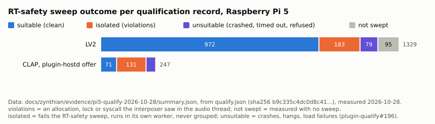

The figure shows the RT-safety outcome of each qualification record in the three classes: suitable (swept clean),
isolated (violations seen), unsuitable (no grid point: the probe crashed, timed out or was refused), or measured
without a sweep (summary.json `rt_safety_records`).

| format | suitable (clean) | isolated (violations) | unsuitable (crashed, timed out, refused) | not swept |
|---|---|---|---|---|
| LV2 | 972 | 183 | 79 | 95 |
| CLAP, plugin-hostd offer | 71 | 131 | 43 | 2 |

This table counts records by their swept grid points, the one above verdicts per host; for CLAP they differ by the two
records that were measured without a sweep.

A violation is an allocation, a lock or a syscall the interposer (`rt_interpose.so`) saw in the audio thread. Over the
grid points swept (1559), 447 show one: 323 with allocations, 366 with locks, 296 with syscalls (a point can show
several). A CLAP probe sweeps at its first rate (44100 Hz), an LV2 probe at the one rate it measured. Every one of our
plugins sweeps clean, in both formats (tables.md).

### Cost, and the grid gap

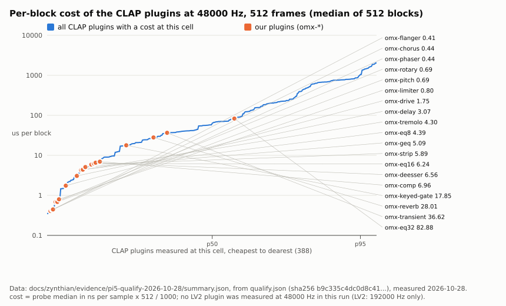

The figure shows the per-block cost of every CLAP plugin measured at 48000 Hz and 512 frames, cheapest to dearest, with
our plugins marked (summary.json).

The probe times each `process()` call, drops 64 warm-up blocks and keeps the median over 512 timed blocks, in
nanoseconds per sample (one frame). The per-block figure is that times 512. A 512-frame block at 48000 Hz lasts
10667 us.

| cell | plugins with a cost | p50 | p90 | p95 | p99 | max | p50 per block, us | p99 per block, us |
|---|---|---|---|---|---|---|---|---|
| CLAP, 48000 Hz, 512 | 388 | 118.5 | 1510 | 2010 | 3673 | 3973 | 60.7 | 1880.6 |
| CLAP, 192000 Hz, 512 | 388 | 110.1 | 1242 | 2732 | 6714 | 12000 | 56.4 | 3437.6 |
| LV2, 192000 Hz, 512 | 1141 | 80.84 | 1148 | 2439 | 5198 | 27490 | 41.4 | 2661.4 |

(ns per sample except the last two columns; summary.json `cost`.) No LV2 plugin was measured at 48000 Hz in this run.

Our plugins at 512 frames (tables.md): ns per sample, median and 95th percentile of the timed blocks.

| plugin | CLAP 48000 median | CLAP 48000 p95 | CLAP per block at 48000, us | LV2 192000 median | LV2 192000 p95 |
|---|---|---|---|---|---|
| omx-chorus | 0.8506 | 799.9 | 0.44 | 592.2 | 805.3 |
| omx-comp | 13.6 | 379.2 | 6.96 | 49.97 | 93.66 |
| omx-deesser | 12.8 | 117.4 | 6.56 | 92.77 | 106.5 |
| omx-delay | 5.987 | 592.4 | 3.07 | 10.74 | 561.1 |
| omx-drive | 3.418 | 333.6 | 1.75 | 267.5 | 440.2 |
| omx-eq8 | 8.572 | 79.62 | 4.39 | 66.39 | 147.4 |
| omx-eq16 | 12.19 | 129.9 | 6.24 | 141.4 | 244.4 |
| omx-eq32 | 161.9 | 238.5 | 82.88 | 254.1 | 439.5 |
| omx-flanger | 0.7969 | 120.3 | 0.41 | 116.2 | 118.6 |
| omx-geq | 9.946 | 497.5 | 5.09 | 255.9 | 501.2 |
| omx-keyed-gate | 34.87 | 91.09 | 17.85 | 81.47 | 120.3 |
| omx-limiter | 1.555 | 158.6 | 0.80 | 147.4 | 151.8 |
| omx-phaser | 0.8682 | 161.9 | 0.44 | 105.4 | 152.2 |
| omx-pitch | 1.34 | 235.5 | 0.69 | 187.4 | 235.8 |
| omx-reverb | 54.71 | 281 | 28.01 | 153.6 | 744.1 |
| omx-rotary | 1.339 | 300 | 0.69 | 289.3 | 291.6 |
| omx-strip | 11.5 | 521.4 | 5.89 | 183.6 | 569 |
| omx-transient | 71.52 | 147.3 | 36.62 | 142.2 | 148.7 |
| omx-tremolo | 8.391 | 19.17 | 4.30 | 17.38 | 19.02 |

Several CLAP medians sit far below their 95th percentile (omx-chorus 0.85 against 799.9): most blocks are cheap and a
few are dear. The CLAP and LV2 builds of one plugin differ at the median by up to nearly three orders of magnitude
(omx-chorus: 0.8496 CLAP against 592.2 LV2, both at 192000 Hz, tables.md); why is not established by these files.

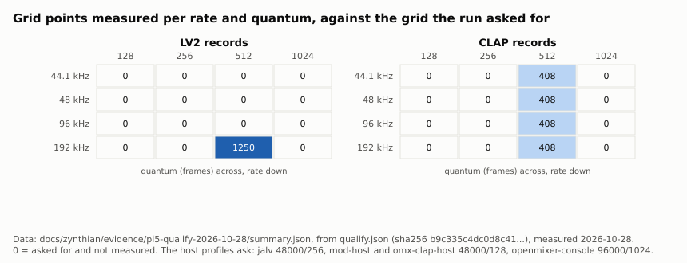

The figure shows how many grid points were measured at each rate and quantum against the 4 x 4 grid the run asked for
(summary.json).

**The grid gap** (plugin-qualify#193). The run asked for 44100, 48000, 96000 and 192000 Hz at 128, 256, 512 and 1024
frames. It measured only 512-frame blocks: CLAP at all four rates (408 points each), LV2 at 192000 Hz only (1250
points). The host profiles rate cost at their own cell (jalv 48000/256, mod-host and omx-clap-host 48000/128,
openmixer-console 96000/1024), none of which was measured, so **every cost rating of every record reads
`hosting.cost.unmeasured-at-rate-and-quantum`**, and the suitability verdicts above rest on RT safety and stability
alone. The per-block cost at Zynthian's own quantum is not measured yet.

The chain round trip
--------------------

[evidence/chain/](evidence/chain/) holds four runs of the chain verbs driven through the zynthian-ui chain code. None ran
on the Pi; all are x86_64 Fedora 44 containers with zyncoder, pyliblo3 and zynautoconnect stubbed.

| file | what | result |
|---|---|---|
| [fake.txt](evidence/chain/fake.txt) | 12 chain scenarios against `tests/fake-host`, 14 sabotages | every scenario `ok`, every sabotage red |
| [e2e.txt](evidence/chain/e2e.txt) | 10 of those scenarios against plugin-hostd 0.10.0 and omx-clap-host from source, with x42 fil4 as the LV2 member | every scenario `ok` |
| [round-trip.txt](evidence/chain/round-trip.txt) | three members (omx-strip, omx-limiter CLAP; omx-delay LV2) played through the chain and compared sample by sample with a reference host | `ROUND TRIP PASS: 0 failed` |
| [round-trip-channel.txt](evidence/chain/round-trip-channel.txt) | the same with plugin-hostd 0.11.0 and omx-clap-host 0.21.0 from the FreeMixer channel | `ROUND TRIP PASS: 0 failed` |

What the round trip proves (round-trip.txt): the chain plays its members in the declared order, bit for bit against the
reference host and not against the other order (peak 0.99078 against 0.32529); removing a member re-forms the chain;
a member that crashes (`fault-14.clap`, which aborts on a parameter write of 0.9 or more) leaves the other three
playing, peak -9.75 dBFS after the crash; and each guard's sabotage turns its scenario red.

On the Pi, the fork's engine ran a chain with omx-eq8 through plugin-hostd on the device's JACK. JACK
ran on the dummy card, and the chain ran. No log of that run is in this tree.

mod-ui's verbs: mod-host against plugin-hostd
---------------------------------------------

From the spike ([spike-report.md](spike-report.md), x86_64 container, plugin-hostd 0.6.0, mod-host
`12335c265374`, Zynthian's mod-ui `817a67234f41`; not re-run on later versions):

| measure | value | file |
|---|---|---|
| distinct verbs mod-ui's source sends | 33 (+2 commented out) | [verbs.tsv](verbs.tsv) |
| commands in the driven session, both daemons | 135 of 16 verbs, the same 135 in the same order | [evidence/path-a/diff.txt](evidence/path-a/diff.txt) |
| replies that differ | 5: `connect ... mod-monitor:in_N` x2 (0 against -902), `feature_enable aggregated-midi` (-202 against 0), `preset_load` of a user preset after a reload x2 (0 against -105) | diff.txt |
| feedback lines that differ | `transport` 6 against 1, `data_finish` 3 against 1 (one per worker) | diff.txt |
| the same session with each LV2 add made a CLAP omx-comp | 150 commands: 45 `resp 0`, 40 `-103`, 22 `-205`, 19 `-902`, the rest other codes | [evidence/path-a/clap-replay.tsv](evidence/path-a/clap-replay.tsv) |

verbs.tsv says verb by verb what differs and the smallest fix. For LV2 the differences are the mod-monitor client,
`feature_enable` to a later worker, and user presets after a reload; for CLAP behind mod-ui, port names, parameters,
presets, state and MIDI mapping do not carry over, because mod-ui reads LV2 TTL. The fork's PH engine does not go
through mod-ui: it speaks the protocol to plugin-hostd itself.

Voices across the cores
-----------------------

Per-block cost and the use of the helper threads with the CLAP thread pool off and on, at 48000 Hz and 128, 256 and 512
frames on the Pi 5, with Surge XT as CLAP if it is built there, else the fixture plugin: the work of
FreeMixer/omx-clap-core#395 (branch `feat/395-thread-pool`), whose evidence is to land in FreeMixer/omx-clap-core
under `docs/evidence/thread-pool-pi5-2026-10-29/`. **Not measured yet**: when this page was written neither the branch
nor that directory existed in FreeMixer/omx-clap-core.

Current versions: chains up to 24 plugins
-----------------------------------------

Run `rpi5-20261031-1`, scenarios `cvc3` to `cvc48`, on a private JACK server on the dummy driver: Pi 5, 4 GB, 48000 Hz, 256
frames, governor `performance`, plugin-hostd 0.15.4, omx-clap-host 0.25.2, omx-plugins 0.16.0, three repeats of 20 s,
medians. omx comp, delay and drive in turn, CLAP under plugin-hostd and omx-clap-host, LV2 builds under mod-host and jalv.
The figures measure the daemon directly, not through Zynthian's engine
([evidence](evidence/pi5-claims-2026-10-31/cvc/rpi5-20261031-1.json)).

| N | mode | processes | JACK clients | JACK DSP % | PSS MB | context switches in 20 s | xruns, median, worst | add ms |
|---|---|---|---|---|---|---|---|---|
| 16 | plugin-hostd, grouped | 2 | 1 | 8.45 | 50.9 | 6023 | 0, 0 | 2052 |
| 16 | plugin-hostd, one worker each | 17 | 16 | 11.29 | 124.8 | 84099 | 0, 30 | 907 |
| 16 | omx-clap-host, one process | 1 | 16 | 10.16 | 50.0 | 65419 | 0, 0 | 431 |
| 16 | mod-host | 1 | 18 | 9.84 | 97.6 | 72292 | 0, 0 | 450 |
| 16 | jalv | 16 | 16 | 11.83 | 687.7 | 75760 | 0, 7 | 14284 |
| 24 | plugin-hostd, grouped | 2 | 1 | 12.92 | 62.8 | 5983 | 0, 0 | 3306 |
| 24 | plugin-hostd, one worker each | 25 | one each | 17.57 | 148.7 | 126900 | 0, 44 | 1497 |
| 24 | omx-clap-host, one process | 1 | 24 | 15.45 | 62.0 | 97592 | 0, 0 | 666 |
| 24 | mod-host | 1 | 26 | 15.05 | 112.0 | 104438 | 0, 0 | 674 |
| 24 | jalv | 24 | 24 | 18.72 | 993.6 | 116687 | 5, 14 | 21420 |

The same chain in LV2 builds on every host, run `rpi5-20261031-1`, scenarios `cvl8` to `cvl24`, plugin-hostd 0.15.5,
omx-clap-host 0.25.3 ([evidence](evidence/pi5-claims-2026-10-31/cvl/rpi5-20261031-1.json)):

| N | mode | processes | JACK clients | JACK DSP % | PSS MB | context switches in 20 s | xruns, median, worst | add ms |
|---|---|---|---|---|---|---|---|---|
| 24 | plugin-hostd, grouped | 2 | 1 | 13.51 | 61.1 | 8986 | 0, 0 | 3559 |
| 24 | plugin-hostd, one worker each | 25 | one each | 19.31 | 157.3 | 131116 | 0, 5 | 1635 |
| 24 | omx-clap-host, one process | 1 | 24 | 16.49 | 60.3 | 105277 | 0, 0 | 838 |
| 24 | mod-host | 1 | 26 | 15.51 | 112.1 | 108719 | 0, 0 | 717 |
| 24 | jalv | 24 | 24 | 19.23 | 993.6 | 113806 | 13, 64 | 21921 |

Ten third-party LV2 effects in series ([tools/zynthian/matrix/plugins.json](../../tools/zynthian/matrix/plugins.json)),
plugin-hostd 0.15.5, omx-clap-host 0.25.3, three repeats of 30 s at 48000 Hz and 256 frames, medians
([1](evidence/pi5-claims-2026-10-31/chain-tp-1/matrix.csv), [2](evidence/pi5-claims-2026-10-31/chain-tp-2/matrix.csv),
[3](evidence/pi5-claims-2026-10-31/chain-tp-3/matrix.csv)). The group is one worker and still ten JACK clients.

| mode | processes | JACK clients | JACK DSP % | PSS MB | xruns over the repeats |
|---|---|---|---|---|---|
| plugin-hostd, grouped | 2 | 10 | 6.04 | 45.0 | 0, 0, 0 |
| plugin-hostd, one worker each | 11 | 10 | 7.19 | 111.1 | 0, 0, 0 |
| omx-clap-host, one process | 1 | 10 | 6.55 | 44.0 | 0, 0, 0 |
| mod-host | 1 | 12 | 6.23 | 89.3 | 0, 0, 0 |
| jalv | 10 | 10 | 6.99 | 463.6 | 25, 5, 14 |

The large gain is over one process per plugin, mainly in memory; mod-host stays close and adds faster. At 32 and 48 plugins the grouped chain did not form within 20 s on one repeat, and in one of four
cells at 18 ([chain-omx-18](evidence/pi5-claims-2026-10-31/chain-omx-18-1/matrix.csv), a chain without omx-keyed-gate);
the cause is not known yet.

Instruments on the cores
------------------------

48000 Hz, 256 frames, on a private server on the dummy driver, read digitally at JACK ports, plugin-hostd 0.15.4 where it
is used. FluidSynth and Pianoteq run on their own, by their own threads, not through plugin-hostd
([FluidSynth](evidence/pi5-claims-2026-10-31/fluid/voices-cores.tsv), [Pianoteq](evidence/pi5-claims-2026-10-31/pianoteq/voices-cores.tsv),
[Surge XT](digital-proofs.md)).

| Instrument | Busy threads | JACK DSP % | xruns per window |
|---|---|---|---|
| Surge XT, one instance, 64 voices, through plugin-hostd | 1 | 27.5 | 0 |
| Surge XT, four instances, 16 voices each, through plugin-hostd | 4, one per worker | 18.8 | 0 |
| FluidSynth, 1200 voices, `cpu-cores=1` | 1 | 68 | 0 to 1 |
| FluidSynth, 1200 voices, `cpu-cores=2` | 2 | 36 | 0 |
| FluidSynth, 1200 voices, `cpu-cores=3` | 3 | 24.5 | 0 |
| FluidSynth, 1200 voices, `cpu-cores=4` | 4 | 19 | 0 |
| Pianoteq 9.2.1 trial, 64 notes, `multicore=4` | 4 | 44 to 49 | 0 to 1 |

The matrix: every rate and quantum, single and grouped
------------------------------------------------------

The rows above hold one or two rates at 256 frames. The matrix runs every cell of

| axis | values |
|---|---|
| rate | 44100, 48000, 96000, 192000 Hz |
| quantum | 128, 256, 512, 1024 frames |
| host mode | jalv (one process per plugin), mod-host (the stock binary, one process, started by the bench on a private port), plugin-hostd single (one worker per plugin, no chain), plugin-hostd grouped (one worker for the chain) |
| plugins | our 19 omx plugins, each alone in its CLAP form (plugin-hostd) and its LV2 form (all three hosts), and all 19 in series as one chain; ten third-party LV2 effects ([tools/zynthian/matrix/plugins.json](../../tools/zynthian/matrix/plugins.json): suitable under jalv, mod-host and omx-clap-host and RT-clean in the deep qualification on plugin-qualify 0.16.1), each alone and all ten as one chain |

and records per cell, after a 60 s hold: the host processes' CPU, RSS and PSS, the processes, the JACK clients the host
put on the graph (`jack_clients`, new in the bench), xruns over the hold, the declared latency and the time to add the
plugins until they run. That is 800 cells (32 chain cells, then 768 single-plugin cells); `tools/zynthian/matrix.py`
writes one CSV row per host and mode and resumes where it stopped:

    tools/zynthian/matrix.py --out out --window 60 --wait-update --after-stress --wait-idle

**Not measured per cell: the per-block cost of the plugin at that rate and quantum.** The probe that measures it times
512-frame blocks only (plugin-qualify#193); the matrix records the host's CPU and JACK's DSP load instead, and the
probe's per-block cost stays in the [qualification section](#cost-and-the-grid-gap).

State: being taken again on current versions, and not published here yet, so every matrix figure below says "not
measured yet". A chain holding omx-keyed-gate is one worker and many JACK clients, so its grouped rows are being replaced by
a chain without that plugin (see [Current versions](#current-versions-chains-up-to-24-plugins)).

Figures, one panel per rate, the measure per quantum, one line per host mode, for the chain of our plugins and the chain
of the third-party ones; a figure with no measured cell says "not measured yet" and names the command:

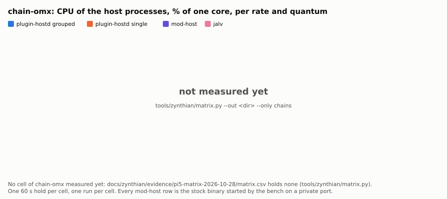

The figure shows the CPU of each host mode running all 19 of our plugins in series, per rate and quantum.

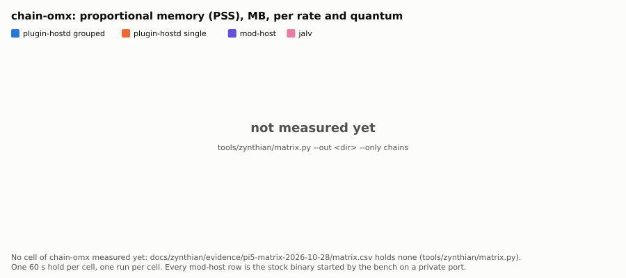

The figure shows the proportional memory of each host mode for the same chain.

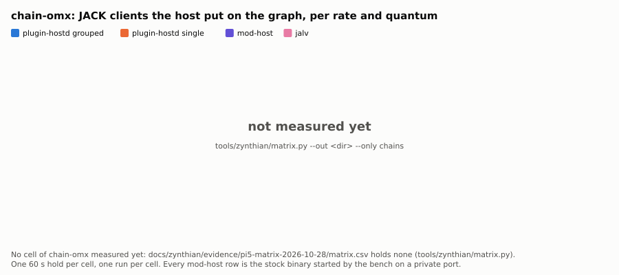

The figure shows how many JACK clients each host mode puts on the graph for the same chain.

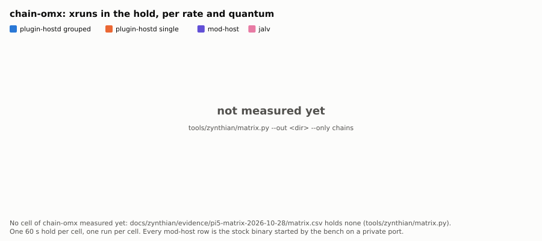

The figure shows the xruns over the 60 s hold for the same chain.

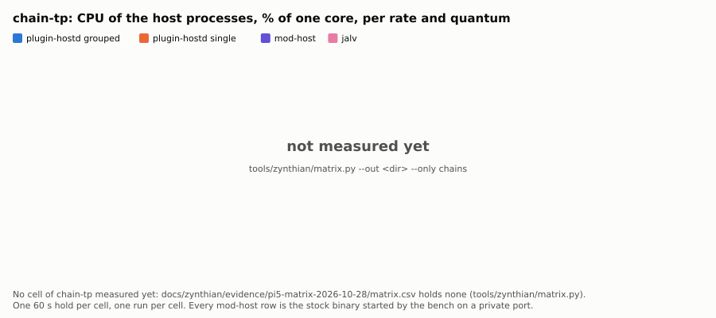

The figure shows the CPU of each host mode running the ten third-party LV2 plugins in series, per rate and quantum.

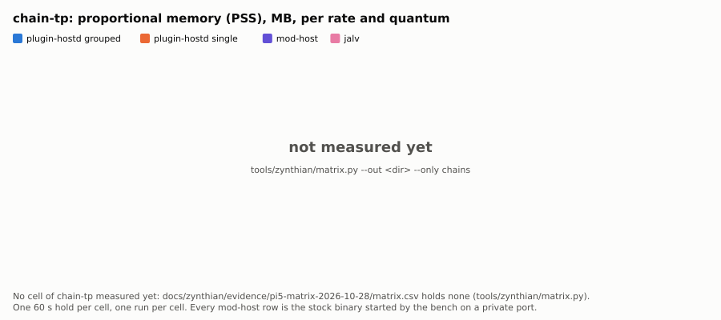

The figure shows the proportional memory of each host mode for the third-party chain.

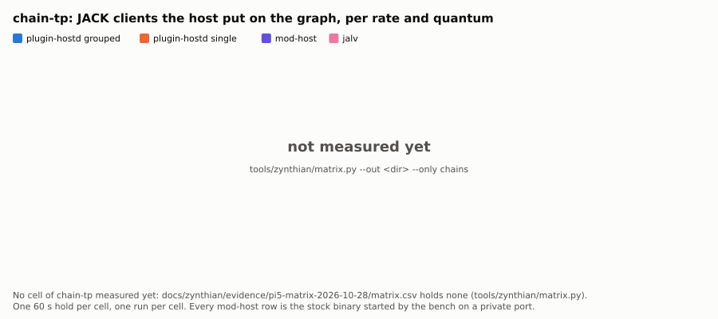

The figure shows how many JACK clients each host mode puts on the graph for the third-party chain.

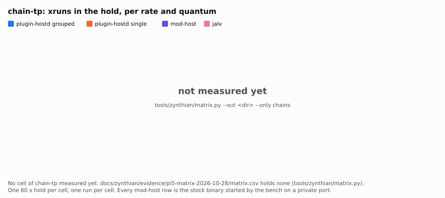

The figure shows the xruns over the 60 s hold for the third-party chain.

What is not measured yet
------------------------

| what | why not | the command that measures it |
|---|---|---|
| audio through a plugin-hostd chain on a Zynthian with an audio interface | next, with the interface | the round trip on the device: `tools/zynthian/chain-e2e.sh --round-trip <zynthian-ui> <out>` with the environment of [README.md](README.md), on a Pi with a card and a loopback |
| cost at the hosts' quantums (128, 256, 1024) and LV2 at 44.1/48/96 kHz | plugin-qualify#193 | `plugin-qualify --all --isolate --rates 48000,96000 --quanta 128,256,512,1024 --host-profile jalv,mod-host,omx-clap-host --format json --out records/ > qualify.json` once #193 is fixed |
| JACK clients per chain for mod-host, counted (jalv's are counted in [stress.md](stress.md)) | not recorded by the bench rows | `jack_lsp` on the bench's private server during a `cvp3` row: `bench/run.sh --class rpi5 --scenarios cvp3 --hosts H3,H4 --rates 48000 --frames 256 --keep-governor --logs logs/` |
| latency measured on audio, per host | needs a loopback through the interface | not available in this tree |
| the cost estimate a chain editor would ask for (FreeMixer/zynthian-ui#13) | no `estimate` verb yet | none yet |
| the MOD-UI engine on plugin-hostd on the device | the fork's update was applied only after these runs | after `update_zynthian_sys.sh` from FreeMixer/zynthian-sys: `tools/zynthian/path-a.sh <out>` |
| Pianoteq 9 under plugin-hostd on the device | in the `rpi5-20261027-1` file (`pianoteq` rows); not repeated with 0.13.1 | `bench/run.sh --class rpi5 --scenarios pianoteq --pianoteq-dir <dir>` |

Reproducing
-----------

    # the bench on the device: a private JACK server per rate and frame count, the live JACK untouched
    bench/run.sh --class rpi5 --out out/ --rates 48000,96000 --frames 256 --keep-governor --logs logs/
    bench/table.sh out/*.json
    # the qualification summary and the figures
    tools/zynthian/qualify-summary.py --qualify qualify.json --records records/ --pins qualified.pins \
        --system-pins /var/lib/omx/qualified.pins --sync-log sync.log --run-log run.log \
        --requested-rates 44100,48000,96000,192000 --requested-quanta 128,256,512,1024 \
        --out docs/zynthian/evidence/pi5-qualify-2026-10-28/summary.json \
        --markdown docs/zynthian/evidence/pi5-qualify-2026-10-28/tables.md
    tools/zynthian/figures.py docs/zynthian/evidence/pi5-qualify-2026-10-28/summary.json docs/zynthian/evidence/figures \
        --date 2026-10-28 --source docs/zynthian/evidence/pi5-qualify-2026-10-28/summary.json \
        --bench docs/zynthian/evidence/pi5-bench-2026-10-27/rpi5-20261027-1.json \
        --bench-name docs/zynthian/evidence/pi5-bench-2026-10-27/rpi5-20261027-1.json --bench-date 2026-10-27
    # the acceptance report
    bench/report/make_report.py --bench docs/zynthian/evidence/pi5-bench-2026-10-27/rpi5-20261027-1.json \
        --results docs/zynthian/evidence/pi5-bench-2026-10-27 --earlier docs/zynthian/evidence/pi5-bench-2026-10-27/earlier \
        --qualification <the records/ directory of the qualification run> \
        --coverage docs/zynthian/evidence/desk-lv2-coverage-2026-10-26/summary.txt \
        --prs docs/zynthian/evidence/prs-2026-10-28.json --out <dir>
