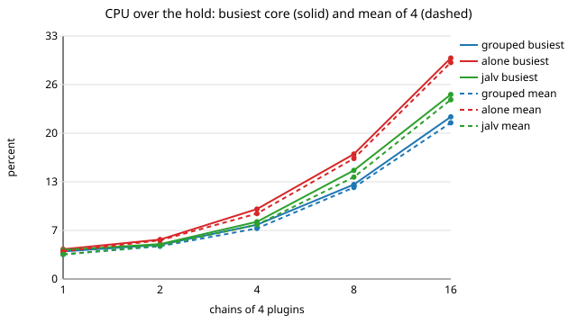
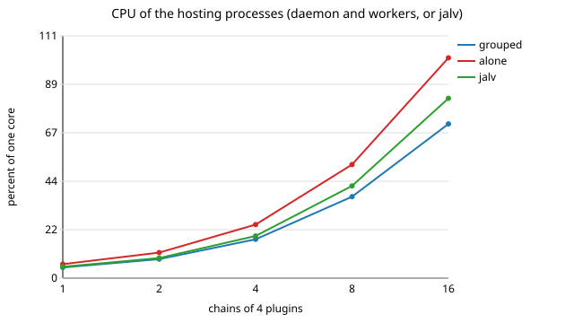
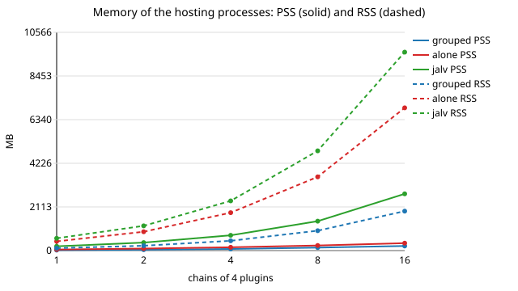
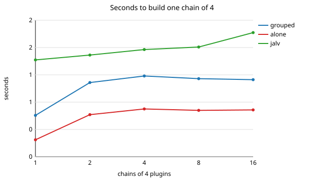
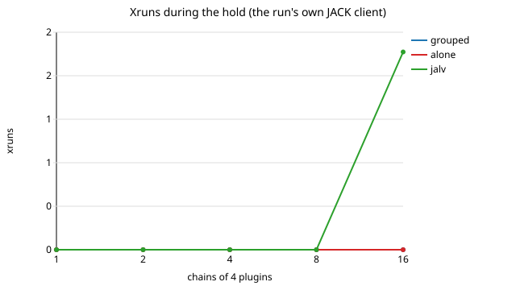

The Pi 5 stress run: grouped, alone and jalv
============================================

Chains of four LV2 plugins, at 1, 2, 4, 8 and 16 chains, on a Zynthian Raspberry Pi 5, hosted three ways:

- **grouped**: plugin-hostd, the four members added and declared one chain with `chain`: one worker per chain;
- **alone**: plugin-hostd, every member added with placement `own`: one worker per plugin;
- **jalv**: one `jalv` process per plugin, the way Zynthian's stock jalv engine hosts an LV2 plugin.

Each level is built from nothing, held 60 s and measured, then removed. The raw data of every level, the captures and
the logs are under [evidence/pi5-stress-2026-10-29/](evidence/pi5-stress-2026-10-29/). The tools are
[tools/zynthian/stress-pi5.sh](../../tools/zynthian/stress-pi5.sh) (run from a laptop),
[tools/zynthian/stress-pi5.py](../../tools/zynthian/stress-pi5.py) (runs on the device) and
[tools/zynthian/stress-figures.py](../../tools/zynthian/stress-figures.py) (the figures and the table below).

The device
----------

From `device.txt` and `packages.txt` of each run:

| | |
|---|---|
| board | Raspberry Pi 5 Model B Rev 1.0, 4 cores, 4049 MB, no swap |
| kernel | 6.18.50+rpt-rpi-2712, `CONFIG_HZ=250` |
| zynthian-ui | FreeMixer/zynthian-ui `vangelis` at `4f0e87fbb8acc8fbfa58a37605bfcb38cacdc6f5` (the branch tip when the run started) |
| zynthian-sys | FreeMixer/zynthian-sys `vangelis` at `aa36238dcb36fc004eaa4e027184adc8e67e8e8b` (the branch tip when the run started) |
| `/etc/systemd/system/mod-host.service` | sha256 `f5f044e1f87f6ca423110116d6542a549122257b2999e7f69f50e6424943b87a`; the unit is inactive and disabled, and so is mod-ui |
| JACK | `jackd -P 70 -s -S -d alsa -d hw:Dummy -r 48000 -p 256 -n 2 -X raw`: **48000 Hz, 256 frames** (`jack_samplerate`, `jack_bufsize`), so a 5.33 ms cycle |
| packages | plugin-hostd 0.13.1, plugin-qualify 0.16.1, omx-plugins 0.15.1, omx-plugins-lv2 0.15.1, omx-clap-host 0.23.2, omx-panel 0.6.0, omx-contract-data 3.4.0, calf-plugins 0.90.3-1kxstudio3, jackd2 1.9.22~dfsg-4 |
| plugin-hostd settings | the image's `/zynthian/config/plugin-hostd.conf`: `lv2_worker auto`, `require_pins 1`, `pin_mode first-use`, `grouping` unset (off) |

The device has no sound card. JACK runs on ALSA's `hw:Dummy` card, so nothing can be heard: the graph runs on a clock
of its own and `system:capture` delivers silence. The run does not judge audio. CPU, memory, xruns, JACK's DSP load and
build times are still the device's own.

**Configuration.** This run measured the device as it was found. The fork's `scripts/update_zynthian_sys.sh` was
**not** run on it, so the units and defaults it would install are not part of this run (see "Not measured"). Before
and after the run: zynthian.service active, mod-host.service and mod-ui.service inactive and disabled,
omx-modgui-sync enabled, Zynthian's own plugin-hostd on port 5570 idle (`worker_list` answered `resp 0`). The run
started its own daemon on port 5590 with zynthian-sys's `sbin/plugin-hostd-start.sh` and the image's configuration
file, and stopped it at the end.

**Core clock.** The cpufreq governor read `performance` (2400 MHz) when the first full run started and `powersave`
(1500 MHz) from its grouped 16-chain level on; nothing in this run changes it, and `vcgencmd get_throttled` read
`0x0`. The grouped levels were therefore run again at 1500 MHz (run `20261029T0010Z`), so **every row of the table
below ran at 1500 MHz** (the `mhz0` column of each level's CSV). The grouped rows at 2400 MHz stay in
`run-20261028T2349Z/levels/` and are not used here.

The plugins
-----------

Even chains are omx-plugins, odd chains plugins of other projects, four consecutive of seven, starting one further on
each time (`chain_members` in `stress-pi5.py`):

- omx-plugins (LV2): `urn:openmixer:eq8`, `comp`, `drive`, `chorus`, `delay`, `reverb`, `limiter`;
- other projects (LV2), each rated suitable in process by its qualification record under `/var/lib/omx/qualification`
  on this device: `http://distrho.sf.net/plugins/3BandEQ`, `http://calf.sourceforge.net/plugins/Compressor`,
  `http://calf.sourceforge.net/plugins/Saturator`, `http://calf.sourceforge.net/plugins/MultiChorus`,
  `http://calf.sourceforge.net/plugins/VintageDelay`, `http://distrho.sf.net/plugins/MaFreeverb`,
  `http://gareus.org/oss/lv2/dpl#stereo`.

plugin-hostd refused `dpl#stereo` with -509 (`PIN_BINARY_MISMATCH`: the installed files differ from the pin the
qualification sync wrote). That plugin appears from 8 chains on, so grouped and alone ran 31 and 60 plugins where jalv,
which checks no pins, ran 32 and 64. `gareus.org/oss/lv2/darc#stereo` was refused the same way in a trial run and
replaced by calf Saturator.

What is measured
----------------

The members of each chain are linked in series from `system:capture` to `system:playback` by the run's own JACK
client. Over the 60 s hold, once a second: the time the scheduler ran tasks on each core (`/proc/schedstat`), the core
clocks, JACK's DSP load and the free memory. At the end of the hold: the CPU time of each process group and of the
eight busiest processes (each thread's `schedstat`), RSS and PSS per process group (`smaps_rollup`), `worker_list`,
the JACK client count (`jack_lsp | cut -d: -f1 | sort -u | wc -l`) and one capture of the screen (`scrot`). Xruns are
counted twice: by the run's JACK client (its xrun callback) and from Zynthian's own counter, the
`XRUN! =>count: N` lines `zynthian_autoconnect` writes to its journal.

- *busiest core* and *mean* are percent of one core over the hold, from `/proc/schedstat`.
- *host CPU* is the CPU time of the hosting processes (the daemon and its workers, or the jalv processes) over the
  hold, in percent of one core.
- *host PSS* and *host RSS* are those processes' memory; *RSS total* adds Zynthian's UI and jackd. RSS counts a
  shared library once per process that maps it, so PSS is the figure to compare.
- *build s* is the time from the first `add` (or the first `jalv` spawn) of the level to the last chain up, and in
  brackets per chain.

A level is the last one of its mode when its busiest core averages over 85 %, its xruns exceed the baseline's by more
than 3, its free memory falls under 400 MB, or Zynthian's UI no longer answers (its process changed, stopped or
in an uninterruptible wait, or the X server gave no capture within 15 s).

**Why the CPU comes from the scheduler and not from `/proc/stat`.** `/proc/stat` is sampled at the tick, and with
`CONFIG_HZ=250` the 4 ms tick beats against JACK's 5.33 ms cycle. The first runs used it, and their machine-wide figure
came out lower, at some levels, than what the busiest processes alone had used, which cannot be. Each level's JSON
keeps both: `cpu_mean` (scheduler) and `tick_cpu_mean` (`/proc/stat`). At the same levels the tick read 1.8 % against
6.8 % (grouped, 4 chains), 6.0 % against 16.2 % (alone, 8 chains) and 25.2 % against 21.0 % (grouped, 16 chains), and
8.8 % against 1.5 % for the idle baseline of run `20261028T2349Z`.

Results
-------

Generated by `tools/zynthian/stress-figures.py docs/zynthian/evidence/pi5-stress-2026-10-29/figures
docs/zynthian/evidence/pi5-stress-2026-10-29/run-20261028T2349Z
docs/zynthian/evidence/pi5-stress-2026-10-29/run-20261029T0010Z`: grouped from run `20261029T0010Z`, alone and jalv
from run `20261028T2349Z`, both baselines kept.

| run | level | host mode | plugins | busiest core % | mean % | host CPU % of a core | JACK DSP % mean / max | host PSS MB | host RSS MB | RSS total MB | xruns (meter / Zynthian) | JACK clients | workers | build s (per chain) | limit |
|---|---|---|---|---|---|---|---|---|---|---|---|---|---|---|---|
| run-20261028T2349Z | idle | baseline | 0 | 1.8 | 1.5 | 0.0 | 0.93 / 1.53 | 0.0 | 0.0 | 474.0 | 0 / 0 | 10 | - | - | - |
| run-20261029T0010Z | idle | baseline | 0 | 2.0 | 1.8 | 0.0 | 1.33 / 1.72 | 0.0 | 0.0 | 457.8 | 0 / 0 | 10 | - | - | - |
| run-20261029T0010Z | 1 | grouped | 4 | 3.7 | 3.3 | 4.9 | 5.22 / 5.91 | 21.6 | 115.5 | 573.5 | 0 / 0 | 11 | 1 | 0.67 (0.673) | - |
| run-20261029T0010Z | 2 | grouped | 8 | 4.6 | 4.4 | 8.7 | 5.33 / 6.03 | 44.0 | 235.5 | 693.6 | 0 / 0 | 15 | 2 | 2.41 (1.207) | - |
| run-20261029T0010Z | 4 | grouped | 16 | 7.3 | 6.8 | 17.8 | 5.98 / 6.77 | 79.5 | 474.6 | 933.1 | 0 / 0 | 20 | 4 | 5.26 (1.314) | - |
| run-20261029T0010Z | 8 | grouped | 31 | 12.7 | 12.3 | 37.3 | 11.34 / 11.74 | 143.9 | 961.1 | 1420.2 | 0 / 0 | 29 | 8 | 10.17 (1.271) | - |
| run-20261029T0010Z | 16 | grouped | 60 | 21.8 | 21.0 | 70.6 | 19.54 / 20.5 | 224.2 | 1910.8 | 2371.1 | 0 / 0 | 46 | 16 | 20.06 (1.254) | - |
| run-20261028T2349Z | 1 | alone | 4 | 4.0 | 3.7 | 6.4 | 5.88 / 6.65 | 52.5 | 444.7 | 919.2 | 0 / 0 | 14 | 4 | 0.28 (0.276) | - |
| run-20261028T2349Z | 2 | alone | 8 | 5.3 | 5.2 | 11.7 | 6.18 / 6.69 | 97.4 | 910.0 | 1384.8 | 0 / 0 | 18 | 8 | 1.37 (0.685) | - |
| run-20261028T2349Z | 4 | alone | 16 | 9.4 | 8.8 | 24.5 | 7.2 / 7.65 | 158.6 | 1835.0 | 2310.5 | 0 / 0 | 26 | 16 | 3.11 (0.778) | - |
| run-20261028T2349Z | 8 | alone | 31 | 16.8 | 16.2 | 52.0 | 13.03 / 13.65 | 246.8 | 3567.7 | 4044.7 | 0 / 0 | 41 | 31 | 6.04 (0.755) | - |
| run-20261028T2349Z | 16 | alone | 60 | 29.7 | 29.1 | 100.8 | 23.65 / 24.58 | 359.3 | 6911.9 | 7391.6 | 0 / 0 | 70 | 60 | 12.19 (0.762) | - |
| run-20261028T2349Z | 1 | jalv | 4 | 3.9 | 3.3 | 5.2 | 5.73 / 5.83 | 205.6 | 595.1 | 1069.3 | 0 / 0 | 14 | - | 1.58 (1.576) | - |
| run-20261028T2349Z | 2 | jalv | 8 | 4.7 | 4.5 | 9.2 | 6.0 / 6.44 | 389.3 | 1197.6 | 1672.1 | 0 / 0 | 18 | - | 3.31 (1.655) | - |
| run-20261028T2349Z | 4 | jalv | 16 | 7.7 | 7.3 | 19.3 | 6.88 / 8.19 | 739.5 | 2406.4 | 2881.2 | 0 / 0 | 26 | - | 6.98 (1.745) | - |
| run-20261028T2349Z | 8 | jalv | 32 | 14.6 | 13.7 | 42.2 | 12.8 / 14.17 | 1424.6 | 4830.6 | 5306.1 | 0 / 0 | 42 | - | 14.29 (1.786) | - |
| run-20261028T2349Z | 16 | jalv | 64 | 24.8 | 24.1 | 82.3 | 24.01 / 42.36 | 2745.6 | 9605.6 | 10066.3 | 2 / 0 | 74 | - | 32.31 (2.02) | memory |

What the table says, at 16 chains, all at 1500 MHz, divided by the plugins each mode ran:

- **CPU of the hosting processes**: grouped 70.6 % of a core for 60 plugins (1.18 % each), alone 100.8 % for 60
  (1.68 % each), jalv 82.3 % for 64 (1.29 % each).
- **Memory (PSS)**: grouped 224.2 MB for 60 plugins (3.7 MB each), alone 359.3 MB for 60 (6.0 MB each), jalv
  2745.6 MB for 64 (42.9 MB each).
- **Building a chain**: alone 0.76 s, grouped 1.25 s (the members are added and then moved into the chain's worker),
  jalv 2.02 s.
- **Where each mode stopped**: grouped and alone reached 16 chains without meeting a limit (busiest core 21.8 % and
  29.7 %, no xrun). jalv reached 16 chains and stopped there on memory: the free memory fell to 375.5 MB, and the
  run's JACK client counted 2 xruns in the hold, with JACK's DSP load peaking at 42.36 %.
- **Xruns**: Zynthian's own counter rose by 0 in every hold; its journal shows 1 xrun since the UI's last start, outside
  the holds. The run's JACK client counted 2, in jalv's 16-chain hold.
- **The UI**: Zynthian's process answered, and the X server gave a capture, at every level.

What else the run found
-----------------------

- **A chain of other projects' plugins is not one JACK client.** The omx-plugins chains form one client,
  `effect_<head>`. For the chains of other projects' plugins, the lv2-clap worker answers the daemon's
  `chain <n> ...` line with -902, while `worker_list` still names one worker of place `chain:<n>` running the four
  members. They then run in one process as four JACK clients, which is why grouped has 46 JACK clients at 16 chains
  where 16 chains of one client each would make 26 with the baseline's 10. Filed as FreeMixer/omx-clap-core#400.
- **The first connect after the ready line was refused.** In every start of the daemon by `plugin-hostd-start.sh`,
  a connect right after it returned was refused, and a retry 0.1 s later was accepted (`first connect after 0.1 s` in
  each `run.log`). Filed as FreeMixer/plugin-hostd#238.
- **jalv -i did not end on SIGTERM.** At jalv's 16-chain teardown, 31 of the 64 processes were still running 10 s after
  SIGTERM and were killed (`jalv_killed_after_sigterm` in `jalv-16.json`). In an earlier run, which waited for each
  process in turn, the teardown stalled for minutes.
- **Pins out of date.** The x42 plugins `dpl#stereo` and `darc#stereo` are refused (-509) because their files no longer
  match the pins of their qualification.

Captures
--------

One capture of Zynthian's screen per level, named `l<chains>-<mode>-zynthian.png`, plus `l00-baseline-zynthian.png`
and `l99-after-zynthian.png` (after teardown), under each run's `captures/`. They show Zynthian's mixer with no
chains. The chains of this run are built on a daemon of their own over plugin-hostd's protocol, so they are not
Zynthian chains and its mixer does not list them. The captures show that the UI kept drawing at each level, not the
chains.

Teardown
--------

After each level every instance is removed (`chain_clear`, then `remove`) and `worker_list` read until none of the
run's instances is left (`teardown_clean: true` in every level's JSON), or every jalv process is ended. At the end
the run's daemon was stopped, and nothing of the run was left running. zynthian.service was active, its screen was
back on the mixer it started on (`l99-after-zynthian.png`), and Zynthian's xrun counter read 1. The root filesystem
was at 15703488 kB used before the run and 15704408 kB after (`df-before.txt`, `df-after.txt`). The run's directory
on the device, `/root/omx-stress-20261028T2349Z/` with the grouped rerun inside it, holds 1.3 MB, of which 840 kB is
an `all.tar` of plugin-hostd sources that this run did not write and that is not part of the evidence.

The commands
------------

From a plugin-hostd checkout, with ssh access to the device as root:

    tools/zynthian/stress-pi5.sh root@zynthian.local <out>                  # the three modes, 60 s holds
    MODES=grouped tools/zynthian/stress-pi5.sh root@zynthian.local <out>    # the grouped rerun at 1500 MHz
    tools/zynthian/stress-figures.py <figure dir> <run dir> [<run dir> ...]

`stress-pi5.sh` writes `device.txt` (commits, unit, JACK rate and quantum, clock), `packages.txt`, `df-*.txt` and
`processes-*.txt`, copies `stress-pi5.py` to `/root/omx-stress-<UTC stamp>/`, runs it there detached with Zynthian's
Python (`/zynthian/venv/bin/python3 -I stress-pi5.py --out <dir> --port 5590 --hold 60 --levels 1,2,4,8,16 --modes
grouped,alone,jalv`) and copies the directory back.

Earlier runs, not used
----------------------

- Two full runs read CPU from `/proc/stat` and are not kept (see the aliasing above).
- One run was stopped at alone 4 chains because another measurement had started on the device.
- The first full run's grouped rows ran at 2400 MHz, before the governor changed. They stay in
  `run-20261028T2349Z/levels/grouped-*` and are replaced in the table by run `20261029T0010Z`.

Not measured
------------

- The fork's updated configuration: `scripts/update_zynthian_sys.sh` was not run on the device, so the
  units, defaults and MOD-UI wiring it would install are not part of this run. Nothing here shows the MOD-UI engine
  reaching plugin-hostd.
- MOD-UI captures: mod-ui was inactive throughout (`modui_active` in each level's JSON), and no browser was at hand on
  the laptop or on the device.
- Captures of the chains in Zynthian's own views: the chains were not Zynthian chains (see Captures).
- Sound, and cost that depends on the signal: no sound card, and the chains' input is the silence of `hw:Dummy`.
- Whether the UI answers a touch or a knob: "answers" here is the process's state and a capture of the X server.
- Any rate or quantum other than 48000 Hz and 256 frames, any clock other than 1500 MHz for the table, more than 16
  chains, chains of other lengths.
- The grouping planner (`plan`): `grouping` is off in the image's settings, and grouped here is the `chain` verb.
- Memory pressure below the 400 MB floor, and what Zynthian does when it runs out.
